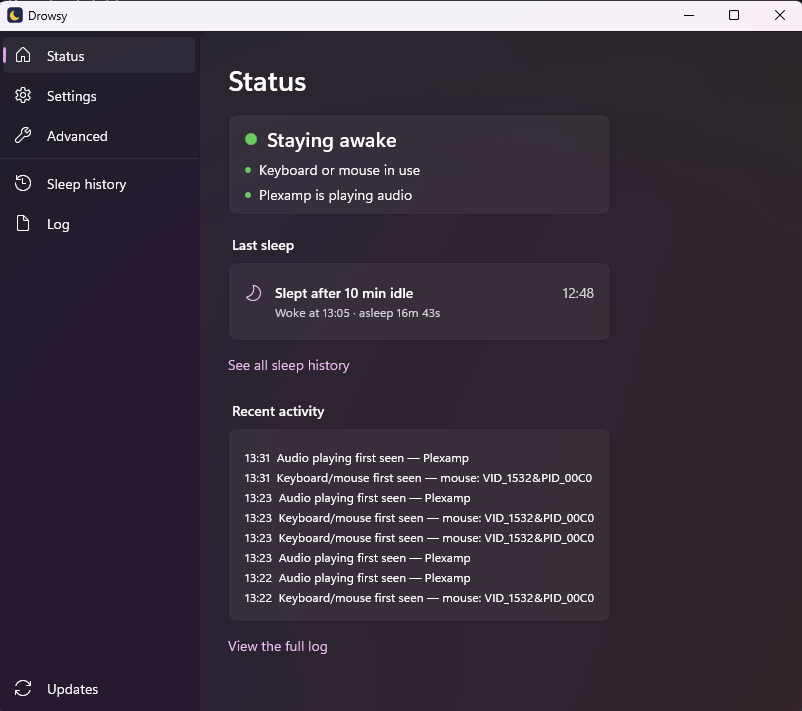
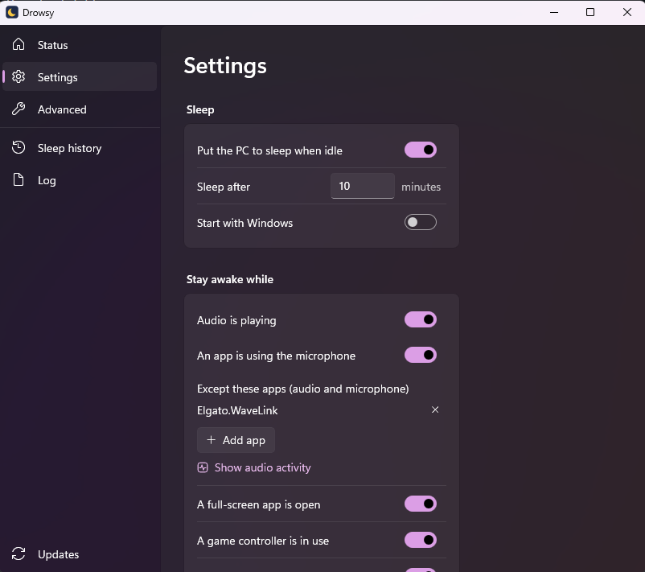
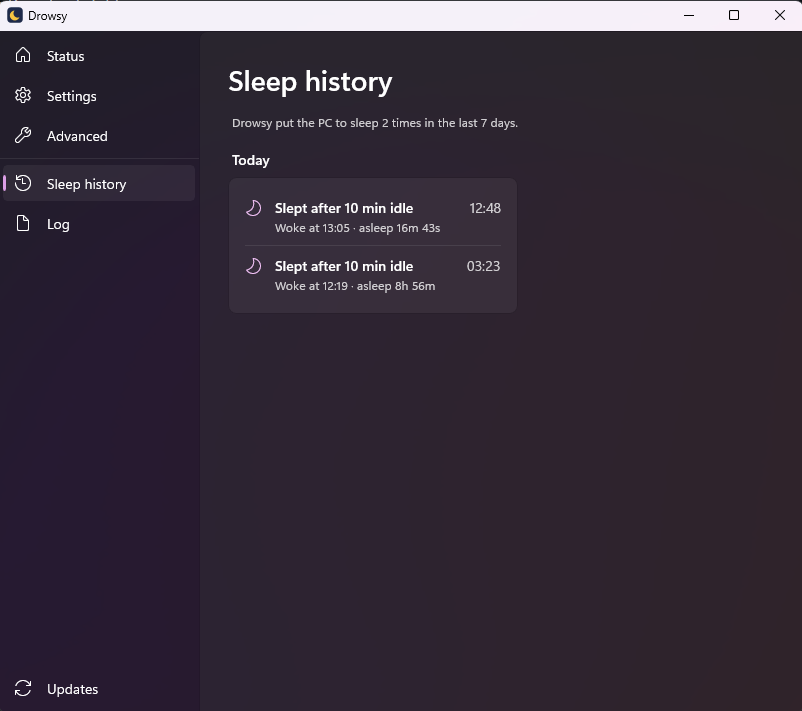
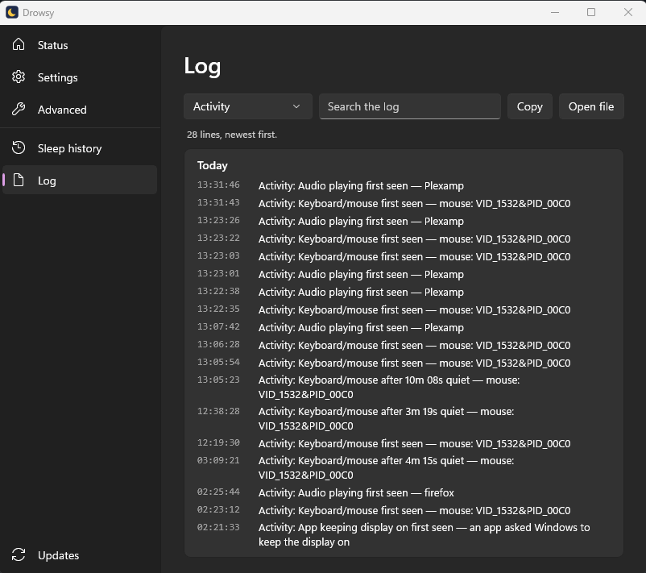

# Drowsy

[](https://github.com/jamesharding/Drowsy/actions/workflows/build.yml)

**Puts Windows to sleep when you're actually idle — even when an audio driver insists you aren't.**

<p align="center"></p>

Windows decides whether to idle-sleep from *power requests*. Audio mixers and interfaces such as
Elgato Wave Link keep a playback stream open permanently, so Windows reports
"An audio stream is currently in use" forever and never sleeps. `powercfg /requestsoverride`
often doesn't help. Drowsy ignores power requests entirely and decides for itself, from
signals that really mean someone is using the PC:

| Signal | Counts as activity when… |
| --- | --- |
| Keyboard / mouse | A physical keyboard or mouse reports a key, click or movement (via Raw Input) |
| Audio | An app's own audio session is audibly playing for 3+ seconds — *real* sound, not just an open stream, and not a one-off notification ping. Mixers (Wave Link) are ignored by default because their output just repeats the apps' audio plus mic monitoring |
| Microphone | An app has the microphone open (calls, recording, dictation) |
| Controller | An XInput (Xbox-compatible) controller changes state (stick drift is ignored) |
| Display request | An app asks Windows to keep the display on (most video players and games) |
| Blocking process | A process you list (e.g. `HandBrake`) is running |

After the configured idle time with none of these, it shows a warning notification, then calls
`SetSuspendState` — the same thing as **Start → Power → Sleep**.

## Features

- Status window and tray tooltip that say in plain English what is keeping the PC awake
- Sleep history: when the PC slept, why, what the last activity was, and when it woke
- Built-in log viewer with filters (sleep and wake, activity, errors) and search
- On/off master switch (window or tray menu) — persists across restarts
- Pick programs, audio apps and input devices from lists (running apps by friendly name,
  keyboards/mice by product name) instead of typing them
- "Stay awake for 30 min / 1 h / 3 h / until resumed", and "Sleep now"
- Warning notification before sleeping; any input cancels it
- Logs the device behind any input after a quiet spell — handy for tracking down phantom input
  that keeps waking or resetting the PC
- `Drowsy.exe --diagnose` writes the input devices and audio apps it can see to the log —
  useful for bug reports
- One-click install and in-app updates from GitHub Releases
- Per-user: no admin rights, and no .NET to install

## Install

1. Download `Drowsy-win-x64.zip` from the [latest release](https://github.com/jamesharding/Drowsy/releases/latest)
   and extract it. It holds `Drowsy.exe` and `Microsoft.WindowsAppRuntime.Bootstrap.dll`, Microsoft's
   small helper that connects the settings window to the Windows App Runtime (below).
2. Run `Drowsy.exe` and choose **Yes** when it offers to install. It copies itself to
   `%LOCALAPPDATA%\Programs\Drowsy`, adds a Start menu shortcut and turns on **Start with Windows**.

Choose **No** to run it from where it is instead. It's a portable folder, and it only offers to
install when started from a temp or Downloads folder.

The status and settings window is built with WinUI 3, from Microsoft's
[Windows App Runtime](https://learn.microsoft.com/windows/apps/windows-app-sdk/downloads) 2.6. Most
Windows 11 PCs already have it, because Microsoft's own apps use it, and Windows keeps it updated.
If it's missing, Windows offers to download it the first time you open the window. The tray app
itself works either way.

> Drowsy isn't code-signed yet, so Windows SmartScreen may warn the first time you run it. An
> unsigned app in a temp or Downloads folder that adds itself to startup also looks like malware
> persistence to Microsoft Defender (`Behavior:Win32/Persistence.A!ml`), which is why Drowsy installs
> itself somewhere permanent first. If Defender flags it anyway, please report the false positive at
> <https://www.microsoft.com/wdsi/filesubmission>.

Drowsy doesn't change your Windows power plan. Your "turn off the display" timer still
applies, and "hibernate after" still applies once the PC is asleep.

### Updates

Drowsy checks GitHub Releases once a day and shows a notification when there's a new version (turn
this off under **Updates**). Nothing is installed until you choose **Install and restart**, which
downloads the release zip, checks it against the release's `.sha256`, swaps the files in place and
restarts. If anything fails part-way, the old version is put back.

The daily check is Drowsy's only network access. It sends nothing but a standard request for the
latest release.

### Uninstall

Right-click the moon icon, untick **Start with Windows**, choose **Exit**, then delete
`%LOCALAPPDATA%\Programs\Drowsy` and the **Drowsy** Start menu shortcut. Settings and logs live in
`%APPDATA%\Drowsy` and `%LOCALAPPDATA%\Drowsy`.

## Status & settings

Left-click the tray icon (or right-click → **Status & settings…**) to open a Windows 11-style
window with a sidebar:

- **Status**: **what is keeping the PC awake right now** (e.g. "Plexamp is playing audio") or how
  long until it sleeps, the last sleep, and recent activity
- **Settings** and **Advanced**: changes save automatically
- **Sleep history**: every sleep, grouped by day, including sleeps started outside Drowsy and
  requests Windows refused
- **Log**: the log, newest first, with filters and search
- **Updates**: the current version, and new versions to install

Hovering the tray icon shows the same status.

| Settings | Sleep history | Log |
| --- | --- | --- |
|  |  |  |

Settings are stored in `%APPDATA%\Drowsy\config.json`:

```jsonc
{
  "enabled": true,                 // master switch
  "idleMinutes": 20,               // sleep after this long with no activity
  "warningSeconds": 60,            // notification this long before sleeping (0 = none)
  "audioIsActivity": true,
  "audioPeakThreshold": 0.001,     // 0..1 peak level; 0.001 ≈ -60 dBFS
  "audioMinSeconds": 3,            // audible seconds (within 10 s) before audio counts
  "microphoneIsActivity": true,
  "ignoredAudioApps": ["Elgato.WaveLink"], // process names whose audio and mic use never count
  "controllerIsActivity": true,
  "honorDisplayRequests": true,
  "blockingProcesses": [],         // e.g. ["HandBrake", "obs64"]
  "ignoreInjectedInput": false,    // ignore SendInput / remote-control input with no device
  "ignoredInputDevices": [],       // substrings of raw-input device paths, e.g. "VID_046D&PID_C52B"
  "checkForUpdates": true
}
```

The log is at `%LOCALAPPDATA%\Drowsy\drowsy.log` and the sleep history at
`%LOCALAPPDATA%\Drowsy\sleep-history.json` (last 500 sleeps).

## Building

Requires the [.NET 11 SDK](https://dotnet.microsoft.com/download) on Windows.

```powershell
# Self-contained and trimmed (no extra tools needed); same as .\publish.ps1
dotnet publish src/Drowsy -c Release -o artifacts/publish

# NativeAOT (smaller, faster start; what releases use) — needs Visual Studio's
# "Desktop development with C++" workload
dotnet publish src/Drowsy -c Release -p:PublishAot=true -o artifacts/aot
```

Only official builds (made by CI from a version tag) check for and install updates. Debug builds,
local publishes and CI builds of branches never do, so they can't replace what you built with the
latest release.

### Releasing

Push a version tag, e.g. `git tag v1.0.1 && git push origin v1.0.1`. CI builds it as an official
build (NativeAOT, stamped with that version, updates switched on) and attaches `Drowsy-win-x64.zip`
and its `.sha256` to a GitHub release. Installed copies pick it up within a day.

### Design notes

- One exe, two processes: the tray engine is plain Win32 (hidden window, `Shell_NotifyIcon`,
  popup menu) and never loads a UI framework; `Drowsy.exe --settings` is a code-only WinUI 3
  window. They talk only through `config.json` and a small `status.json` the engine writes while
  the window is open.
- .NET is self-contained (compiled in by NativeAOT); WinUI is framework-dependent. The Windows App
  SDK's automatic start-up code is switched off, and only the settings window calls the
  bootstrapper (`Bootstrap.TryInitialize` with `OnNoMatch_ShowUI`), so the tray engine never loads
  WinUI and runs even without the runtime.
- All interop is source-generated (`LibraryImport`, `[GeneratedComInterface]` with
  `StrategyBasedComWrappers`, System.Text.Json source generation), so the app is trimming- and
  NativeAOT-safe with no reflection.
- Runs as the signed-in user, not as a service: input and audio sessions are per-user, and a
  service can't see them.
- Updating replaces files in place: Windows lets a running exe or DLL be renamed but not deleted,
  so the current files are moved aside to `*.old`, the new ones copied in, and the old ones removed
  on the next start.

## Limitations

- Controllers that don't speak XInput (some PlayStation / Switch pads without Steam Input) aren't
  detected yet.
- If something is genuinely producing input (a faulty mouse, remote-control software), Drowsy
  will see it too; use the log and `ignoredInputDevices` / `ignoreInjectedInput` to filter it.

## Licence

[MIT](LICENSE) © 2026 James Harding
